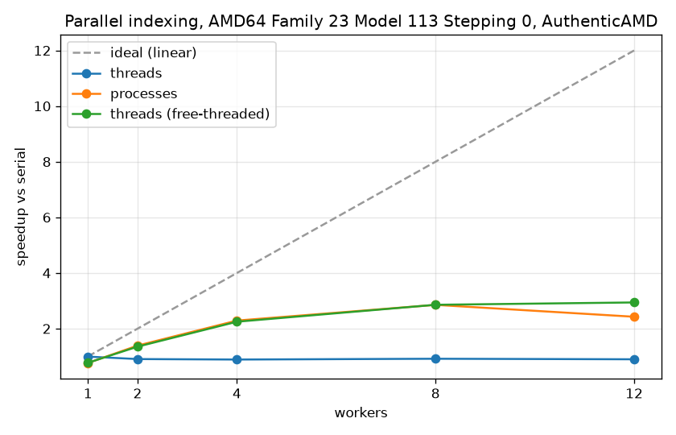

# findex

A full-text search engine built from scratch, one lab at a time.
**Lab 01:** a corpus loader and tokenizer that stream the corpus instead of loading it.

## Corpus

Public-domain books from [Project Gutenberg](https://www.gutenberg.org/), one book = one document,
licence header/footer stripped. `data/` is git-ignored; to get the corpus:

```bash
uv run python scripts/fetch_gutenberg.py          # ~40 popular books into data/gutenberg/
uv run python scripts/fetch_gutenberg.py 1342 84  # or pick ebook IDs
```

`iter_documents` also reads directories of `.txt`, JSON-lines files (`{"text": ...}` per line,
e.g. arXiv abstracts), and `.gz` / `.bz2` versions of both without extracting them.

## Usage

```bash
uv sync
uv run python -m findex.stats data/                # doc count, tokens, vocab, top-50, time, peak mem
uv run python -m findex.stats data/ --limit 10     # first 10 documents only (itertools.islice)
uv run python -m findex.stats data/ --compare      # eager vs lazy, as a markdown table
uv run pytest
uv run ruff check
uv run python scripts/repl_experiments.py          # the five "prove it to yourself" experiments
```

## Layout

| File | What |
|---|---|
| `src/findex/corpus.py` | `iter_documents(root) -> Iterator[Document]` — generator, one file open at a time |
| `src/findex/tokenize.py` | `tokenize(text) -> Iterator[str]` — NFC → casefold → `re.finditer` |
| `src/findex/stats.py` | the lazy pipeline, the eager twin, `tracemalloc` measurement, CLI |
| `tests/` | tokenizer policy checks + corpus loader checks |

## Tokenizer policy

| Case | Input | Tokens |
|---|---|---|
| case | `Straße STRASSE` | `strasse`, `strasse` (`casefold`, not `lower`) |
| accents | `café` vs `cafe` + U+0301 | both `café` (NFC) |
| apostrophe inside a word | `don't`, `don’t`, `п'ять`, `пʼять` | kept, unified to `'` |
| quotes around a word | `'quoted'` | `quoted` |
| hyphen | `state-of-the-art` | `state`, `of`, `the`, `art` |
| digits | `Python3 2008 3.14` | `python3`, `2008`, `3`, `14` |
| underscore | `snake_case` | `snake`, `case` |

Letters are any Unicode letter/digit (`\w` minus `_`), so Cyrillic, Greek and CJK work.
Combining marks stay attached to their letter when NFC has no precomposed form.

## Eager vs lazy

Measured with `python -m findex.stats data/ --compare` (same corpus, same tokenizer, `tracemalloc`
peak; tracemalloc slows both runs equally).

| Version | Documents | Tokens | Peak memory | Elapsed |
|---|---|---|---|---|
| eager (lists) | 40 | 5,855,520 | 406.3 MiB | 44.83 s |
| lazy (generators) | 40 | 5,855,520 | 54.9 MiB | 40.63 s |

Corpus: 40 Gutenberg books, 32.6 MB on disk, 76,552 distinct terms. Windows 11, CPython 3.12.10.
Both versions produce the identical `Counter` (the `--compare` run asserts it).

The eager version keeps everything alive at once: all 40 decoded texts (a 32 MB corpus becomes
~60 MB of `str`, because a single curly quote forces CPython to store a whole book at 2 bytes per
character), then a list of lists holding 5.9 million token references, then a second flat list of
the same 5.9 million references, and only then the `Counter`. Each list slot is an 8-byte pointer
plus a separate string object per token, which is why it reaches ~400 MiB: over 10× the corpus
size. The lazy version never holds more than one book. Its peak is set by the largest book
(Les Misérables, 3.3 MB): the raw bytes, the decoded `str` (6.4 MiB), the NFC and casefolded
copies, and `unicodedata`'s temporary buffer, together with the `Counter` (5.5 MiB, still in
memory after the run because it *is* the answer). Memory isn't zero because a document is the
unit of streaming. To go lower, tokenize line by line instead of book by book. The lazy run is
also slightly faster: it never allocates or frees millions of list slots.

> After Lab 1 one book (ebook 30254) was swapped for Plato's *Republic* (1497), and from Lab 2 on
> the books are split into ~1,500-word sections (`scripts/make_sections.py`): **3,876 documents**
> in `data/sections/`, a corpus where ranking has something to rank.

## Lab 02 — the inverted index

```bash
uv run python scripts/make_sections.py
uv run python -m findex.index data/sections --out index.fidx --positions
uv run python -m findex.search index.fidx "whale ship NOT boat" --boolean --engine merge
uv run python scripts/bench_lab02.py data/sections      # all three tables below
```

* `index.py` — one streaming pass: each document's terms are counted in a per-document `Counter`
  (or position lists with `--positions`) and flushed into `defaultdict(PostingList)` when the
  document ends, so postings come out sorted by doc id for free. `Posting` and `DocMeta` are
  `@dataclass(frozen=True, slots=True)`, hashable values.
* `setops.py` — two-pointer merge for AND / OR / AND-NOT, and a set-based engine behind the same
  interface (`--engine merge|set`).
* `store.py` — `pickle` and a binary `.fidx` format: postings as raw `uint32` arrays, a JSON header
  mapping term → byte offset, zlib-compressed document texts. `.fidx` can be loaded eagerly or
  `mmap`ed lazily, so load time stops depending on index size. It holds only data, so it's safe to load
  a downloaded file. **`pickle` is not**: unpickling runs whatever callable the file names
  (`__reduce__`), so loading a downloaded `.pkl` is remote code execution. Only load pickles you wrote.

### Postings representation (3,876 docs, 5.8 M tokens, 76,766 terms, no positions)

| Postings representation | Peak memory (build) | Index file size (pickle) | Load time |
|---|---|---|---|
| `list[Posting]` with plain `@dataclass` | 204.0 MiB | 41.7 MiB | 1.85 s |
| `list[Posting]` with `slots=True` | 135.3 MiB | 33.1 MiB | 7.08 s |
| `array('I')` pairs (doc_ids, tfs) — no objects | **43.4 MiB** | **20.5 MiB** | **0.21 s** |

There are ~1.2 M postings. As a plain dataclass, each posting is a full object: 16 bytes of header,
a pointer to its own `__dict__`, and the dict itself (~100+ bytes for two keys), plus the 8-byte
slot in the list that points at it. That's roughly 150 bytes per posting. `slots=True` deletes the
`__dict__`: the instance becomes a header plus two inline pointers (48 bytes). The ints themselves
are mostly small-int singletons, so they cost nothing extra. With `array('I')` there are no objects
at all: one posting is two 4-byte machine integers in a contiguous buffer, ~8 bytes. The
remaining ~40 MiB is the dict of 77 K term strings and per-array overhead. The pickle numbers say
the same thing, plus one surprise: slotted *frozen* instances load 4× slower than plain ones. A
frozen slotted class has no `__dict__` to fill, so unpickling calls `__setstate__`, which goes
through `object.__setattr__` once per field per object. An array unpickles as a single `bytes`
copy. **Production `findex` therefore stores arrays** (`PostingList`) and creates `Posting`
objects only on demand.

### Two-pointer merge vs `set` (µs per operation)

| Query | df | merge | set | Faster |
|---|---|---|---|---|
| `and` AND `to` (two most common) | 3,876 / 3,876 | 861 | 348 | set 2.5× |
| `and` OR `to` | 3,876 / 3,876 | 895 | 348 | set 2.6× |
| `publick` AND `1729` (two rarest, df ≥ 2) | 2 / 2 | 1 | 1 | tie |
| `publick` OR `1729` | 2 / 2 | 1 | 1 | tie |
| `to` AND `tumbling` (common × mid) | 3,876 / 50 | 581 | 114 | set 5.1× |

On paper the merge wins: O(n + m) with no hashing and no final sort. In CPython the set engine
still wins on the big lists because `set(a) & set(b)` runs entirely in C, while the merge pays
interpreter overhead (bytecode dispatch, boxing ints out of the array) on every step. On tiny lists
the two are equal because call overhead dominates. The merge's real advantages show up later: it
streams, keeps order without a sort, and vectorizes (Lab 8). `merge` stays the default for those
reasons, and `--engine set` is there for comparison.

### Storage formats

| Index | Format | File size | Save | Load |
|---|---|---|---|---|
| no positions | pickle | 37.1 MiB | 0.70 s | 341 ms |
| | `.fidx` eager | 34.7 MiB | 0.62 s | 473 ms |
| | `.fidx` mmap (lazy) | 34.7 MiB | 0.57 s | **141 ms** |
| with positions | pickle | 60.8 MiB | 0.91 s | 661 ms |
| | `.fidx` eager | 57.3 MiB | 0.53 s | 618 ms |
| | `.fidx` mmap (lazy) | 57.3 MiB | 0.72 s | **155 ms** |

Sizes include ~19 MiB of compressed document text (needed for snippets and the document view).
Positions add ~23 MiB, about 2.3× the postings alone, and build peak memory goes from 60 to 90 MiB.
The positions flag stays on: phrase queries and snippets depend on it. The lazy load costs
about the same whether or not positions are stored, because it only parses the header and maps
the file.

## Lab 03 — ranking, the query language, and a real `Index`

```bash
uv run python -m findex.search index.fidx '"white whale" captain' --k 3 --repeat 2 -v
uv run python scripts/eval_lab03.py index.fidx
```

* **`Index` is a `collections.abc.Mapping[str, PostingList]`:** `len(ix)`, `"whale" in ix`, `ix["whale"]`
  (`KeyError` if absent), `for term in ix`, `repr(ix)`. Also `num_docs`, `avg_doc_length`
  (`cached_property`), `doc_length()`, `df()`, `text()`. `Mapping` brings an `__eq__`, which sets
  `__hash__ = None`, so `Index` restores identity equality and hashing: an index is an entity, not
  a value, and the query cache needs to hash it. `store.open_index()` is a `@contextmanager` that
  closes the mmap even when the `with` body raises (tested).
* **Ranking (`scoring.py`):** a `Scorer` protocol with `score(term, posting, index)`, implemented
  by `TfIdf` and `BM25(k1=1.5, b=0.75)`. `search()` adds up scores per document and takes the top k
  with `heapq.nlargest` (O(n log k), not O(n log n)). It returns a `ResultList`, a `Sequence` whose
  slices keep `.total`, made of `SearchResult` dataclasses with `order=True` that sort best-first.
* **Query language (`query.py`):** a recursive-descent parser builds `Term` / `Phrase` / `And` / `Or` / `Not`
  frozen dataclasses (which overload `&`, `|`, `~`). It handles implicit AND, `OR`, `NOT`,
  parentheses and `"quoted phrases"` (checked against positions). Tests compare trees, for example
  `parse('a OR b c') == Or(Term('a'), And(Term('b'), Term('c')))`. `a NOT b` is evaluated as a
  difference, never as "everything minus b".
* **Decorators and caching:** `@timed` (with `functools.wraps`) on `build_index`, `save`, `load`,
  `matching_ids`, `search`. `functools.lru_cache(256)` on query → matching ids. In the log below,
  a repeated query skips parsing and evaluation:

  ```text
  DEBUG findex.timing: matching_ids took 1.5 ms
  DEBUG findex.timing: search took 2.1 ms
  DEBUG __main__: query cache hit for '"white whale" captain'
  DEBUG findex.timing: matching_ids took 0.1 ms
  DEBUG findex.timing: search took 0.5 ms
  ```
* **Snippets (`snippets.py`):** a ±80-character window centred on the match that covers the most
  distinct query terms, snapped to word boundaries, with spans the caller renders as `«plain»`,
  rich markup, or `<mark>`-escaped HTML.

  ```text
  1.  15.472  Moby-Dick — part 43/141
      …“«Captain» Ahab,” said Tashtego, “that «white» «whale» must be the same that some call…
  ```

### Ranking sanity checks (BM25, real corpus)

1. **Rare beats common.** `harpoon` has df 40 and idf 4.56; `sea` has df 687 and idf 1.73. For
   `harpoon OR sea`, all 5 of the top 5 contain `harpoon`, even though hundreds of sections say
   `sea` more often.
2. **Saturation.** At average length, the BM25 tf weight for tf = 1, 2, 5, 10, 19, 20 is 1.000,
   1.429, 1.923, 2.174, 2.317, 2.326. The 20th repetition adds 0.0085, 0.9% of what the first one
   added. (TF-IDF's `1 + ln tf` would still add 0.05.)
3. **Short beats long.** `telescope` appearing once in a 1,175-token section scores 5.601; once in
   a 1,571-token section, 4.955. The same checks run as unit tests on the fixture corpus
   (`tests/test_search.py`).

### precision@5 — TF-IDF vs BM25

Ten queries written to avoid character names. A section counts as relevant if it comes from the
book the query is about (`eval/queries.json`). The words are OR-ed so ranking decides.

| Query | Relevant book | TF-IDF | BM25 |
|---|---|---|---|
| whale ship captain harpoon | Moby-Dick | 1.0 | 1.0 |
| detective crime clue | The Adventures of Sherlock Holmes | 0.6 | 0.8 |
| vampire blood garlic | Dracula | 0.8 | 0.8 |
| battle emperor army retreat | War and Peace | 0.8 | 0.8 |
| prince fortune cruelty state | The Prince | 1.0 | 1.0 |
| marriage fortune ball sisters | Pride and Prejudice | 0.8 | 1.0 |
| pirates treasure island map | Treasure Island | 1.0 | 0.8 |
| creature creation science despair | Frankenstein | 0.8 | 0.8 |
| sovereign commonwealth covenant | Leviathan | 1.0 | 1.0 |
| justice soul guardians city | The Republic | 1.0 | 1.0 |
| **mean** | | **0.88** | **0.90** |

The sample is small and noisy, and both scorers are good when the words are distinctive. The
differences come from saturation. For *detective crime clue*, TF-IDF lets a *Tom Sawyer* section
into the top 5 on the strength of repeating one word; under BM25 extra repetitions are worth
little, so a fourth Holmes story takes that place. Saturation also explains BM25's one loss: on
*pirates treasure island map*, Treasure Island's sections no longer get much credit for saying
"island" and "treasure" over and over, so an *Odyssey* section about islands reaches #2. Sections
are all about 1,500 words, so length normalization barely matters here.

## Lab 04 — a real tool: typed, tested, packaged

<!-- After pushing to GitHub, replace OWNER/REPO: -->
[](https://github.com/OWNER/REPO/actions/workflows/ci.yml)

```bash
uv tool install .                     # puts `findex` on PATH
findex index data/sections --out index.fidx
findex search index.fidx '"white whale" captain' -k 5
findex search index.fidx 'whale OR ship' --json | jq .title
findex stats index.fidx
findex -vv search index.fidx 'whale'  # timing + cache logs on stderr
```

From a release wheel, on any machine with `uv`:

```bash
uv build                                              # dist/findex-0.4.0-py3-none-any.whl
uvx --from ./dist/findex-0.4.0-py3-none-any.whl findex --help
uv tool install https://github.com/OWNER/REPO/releases/download/v0.4.0/findex-0.4.0-py3-none-any.whl
```

* **Typing:** `pyright` in strict mode, 0 errors. `Scorer` is a `typing.Protocol`. Generators are
  typed `Iterator[...]` and accept `Iterable[...]`; `Literal` is used for the engine, executor and
  scorer names; `@timed` uses PEP 695 generics (`def timed[**P, R]`) so decorated functions keep
  their signatures. Each of the four `# pyright: ignore` comments has its reason next to it
  (untyped JSON values, and a typeshed generic on `TextIOWrapper`).
* **Tests:** 80 pytest tests. A session-scoped fixture corpus lives in `conftest.py`. The tokenizer
  tests are parametrized and include Unicode. The query parser is tested by tree equality, the
  three Lab 3 ranking checks run as tests, save/load round-trips through both formats and the mmap,
  and the CLI runs through `typer.testing.CliRunner`. **Five Hypothesis properties:** merge equals
  set algebra; tokens are never empty and never contain whitespace; the tokenizer is
  case-insensitive and stable on ASCII text; any query tree survives `parse(str(tree))`; and any
  small corpus keeps its index invariants and survives a save/load round trip.
* **Coverage: 81%** of the package (branch coverage). What isn't covered, and why: the
  `python -m findex.index/search` argparse mains, which are thin Lab 2 entry points now superseded
  by the CLI; the decode-error and unreadable-archive branches in `corpus.py`; and `parallel.py`,
  which is Lab 5's code arriving early. Excluding `parallel.py`, statement coverage is 89%.
* **CLI:** a `typer` app with `index` (a `rich` progress bar on stderr), `search` (a `rich` table
  with highlighted snippets, or `--json` lines on stdout) and `stats`. `-v`/`-vv` set the log level.
  Logging is configured once in `cli.py` and every diagnostic goes to stderr. Expected failures print
  one line and exit nonzero: a missing file exits 1, a bad query exits 2.
* **Packaging:** PEP 621 `pyproject.toml`, the version read from `findex/__init__.py`, a `dev`
  dependency group, `[project.scripts] findex = "findex.cli:app"`, `py.typed`, and a committed
  `uv.lock`. `uv build` produces the wheel above. It was verified in a clean, isolated environment
  with `uvx --from dist/…whl findex --help`.
* **CI:** `.github/workflows/ci.yml` runs ruff, `ruff format --check`, pyright and pytest with
  coverage on Python 3.12 and 3.13, then builds the wheel. Pushing a `v*` tag attaches the wheel to
  a GitHub Release.

> **Windows note (long paths):** if the project lives under a very long path, files deep inside `.venv` can
> exceed the 260-character `MAX_PATH` limit and fail to import. The symptom is
> `ImportError … (unknown location)`. Point uv at a shorter venv path with
> `UV_PROJECT_ENVIRONMENT=C:\venvs\findex`, or enable long paths in Windows.

## Lab 05 — parallel indexing and the GIL

```bash
findex index data/sections --executor processes --workers 8   # the default
findex index data/sections --executor threads --workers 8
uv run python scripts/bench_lab05.py cpu --runs 3              # every config in a fresh process
uv python install 3.13t
uv run python scripts/bench_lab05.py cpu --python "$(uv python find 3.13t)" --label free-threaded --executors threads
uv run python scripts/bench_lab05.py report                    # table + docs/lab05_speedup.png
```

`parallel.py` splits the sorted path list into contiguous chunks (4 per worker, for load
balancing) and calls `build_partial(paths) -> PartialIndex` on each. Workers get **paths, not
documents**: a path is ~100 bytes to pickle, a document is ~10 KB. Each partial numbers its
documents from 0. `merge()` concatenates partials in chunk order and shifts each chunk's ids
by the number of documents before it. That makes the parallel index **byte-identical** to the
single-pass build, for serial, threads and processes alike (`tests/test_parallel.py` compares
the saved `.fidx` bytes). `build_partial` is a module-level function that takes only arguments,
so it pickles by reference. The pool is created only inside the CLI command (spawn-safe). A
worker exception re-raises in the parent with the worker's traceback chained, and pending
chunks are cancelled.

**Machine:** AMD Ryzen 5 3600 (6 cores / 12 threads), 16 GB RAM, Windows 11, CPython 3.12.10 and
3.13.18 free-threaded. The corpus is 3,876 documents (32 MB) indexed with positions and stored
texts. Each configuration ran 3 times in a fresh process and the table shows the median. CPU
is parent CPU plus every worker process's CPU. Peak RSS is the parent's peak working set.

| Executor | Python | Workers | Wall (s, median) | CPU (s) | Peak RSS (parent) | Merge (s) | Speedup |
|---|---|---|---|---|---|---|---|
| serial | 3.12 | 1 | 16.13 | 15.7 | 193 MiB | 0.36 | 1.00× |
| threads | 3.12 | 1 | 16.24 | 16.0 | 224 MiB | 0.60 | 0.99× |
| threads | 3.12 | 2 | 17.80 | 18.3 | 249 MiB | 0.82 | 0.91× |
| threads | 3.12 | 4 | 18.15 | 19.3 | 281 MiB | 0.98 | 0.89× |
| threads | 3.12 | 8 | 17.59 | 19.0 | 326 MiB | 0.92 | 0.92× |
| threads | 3.12 | 12 | 17.96 | 20.0 | 356 MiB | 1.25 | 0.90× |
| processes | 3.12 | 1 | 21.08 | 19.6 | 229 MiB | 1.17 | 0.76× |
| processes | 3.12 | 2 | 11.60 | 21.1 | 255 MiB | 1.26 | 1.39× |
| processes | 3.12 | 4 | 7.04 | 22.6 | 286 MiB | 1.29 | 2.29× |
| **processes** | 3.12 | **8** | **5.65** | 28.6 | 332 MiB | 1.33 | **2.85×** |
| processes | 3.12 | 12 | 6.65 | 34.2 | 363 MiB | 1.73 | 2.43× |
| threads | 3.13t (no GIL) | 1 | 20.90 | 19.4 | 235 MiB | 0.77 | 0.77× |
| threads | 3.13t (no GIL) | 2 | 11.92 | 21.6 | 263 MiB | 0.82 | 1.35× |
| threads | 3.13t (no GIL) | 4 | 7.17 | 23.7 | 301 MiB | 0.97 | 2.25× |
| threads | 3.13t (no GIL) | 8 | 5.64 | 29.6 | 363 MiB | 1.17 | 2.86× |
| threads | 3.13t (no GIL) | 12 | 5.48 | 31.2 | 397 MiB | 1.36 | 2.94× |



**I/O-bound counter-benchmark** (`bench_lab05.py io`): 50 requests to a local server that waits
100 ms per response, using a `ThreadPoolExecutor` on the normal GIL build:

| Threads | Wall (s) | Speedup |
|---|---|---|
| 1 | 5.15 | 1.0× |
| 2 | 2.55 | 2.0× |
| 4 | 1.37 | 3.8× |
| 8 | 0.72 | 7.2× |
| 16 | 0.62 | 8.4× |
| 50 | 1.14 | 4.5× |

### What happened, and why

**Threads didn't scale under the GIL.** Indexing is pure-Python CPU work: regex matching,
`Counter` updates, dict inserts. Only the thread holding the GIL can execute Python bytecode, so
eight threads take turns on one core. Each switch (forced every 5 ms) costs a context switch
and cache misses. That's why wall time *rises* slightly (0.9×) while total CPU grows from 15.7 s
to 19–20 s: extra work, no extra parallelism. The I/O benchmark is the same thread pool on the
same interpreter, but there threads scale almost linearly up to 8, because a thread waiting on a
socket releases the GIL. Waiting is the one thing threads can do in parallel under the GIL. (At
50 threads the toy server, which runs in the same process, becomes the bottleneck.)

**Processes scaled, and you can see the cost.** Each process has its own interpreter and its own
GIL. At 8 workers wall time drops from 16.1 s to 5.65 s (2.85×), but CPU rises from 15.7 s to
28.6 s. The extra ~13 CPU-seconds are the **pickling tax**: eight interpreters start up and
re-import findex (spawn), every partial index (postings, positions, compressed texts) is pickled
in the worker, sent through a pipe, and unpickled in the parent, and two hyperthreads sharing a
physical core each run slower than one alone. The process ×1 row isolates that overhead: the
same work as serial plus one round of pickling costs 21 s instead of 16 s. Parent RSS grows with
workers because the parent holds every unpickled partial plus the merged index at once. 12
workers is slower than 8: the CPU has only 6 physical cores, and more chunks make a bigger merge.

**Amdahl's law is visible in the merge column.** The merge runs serially in the parent, and it
gets *slower* as there are more partials. Each term's postings are touched once per chunk, and
every doc id is shifted in a Python loop: 1.33 s at 8 workers, versus 0.36 s for the serial
build's trivial one-chunk merge. Add the parent's work receiving and unpickling results, and
roughly 2 s of the 5.65 s is serial. With a serial fraction of ~12%, the speedup on 6 real cores
can't exceed 1 / (0.12 + 0.88/6) ≈ 3.7×. 2.85× is what's left after the pickling tax. Infinite
cores would cap out at 1/0.12 ≈ 8×.

**Free-threaded 3.13t** removes the GIL, and the *threaded* build now scales just like processes
(2.86× at 8, 2.94× at 12) with no pickling, because results stay in shared memory. It costs
~30% in single-thread speed: 20.9 s vs 16.1 s for one thread, from the free-threaded build's
per-object locking and reference counting, plus 3.13 disabling some of its specializations.
It also used more memory. At 12 threads it is the fastest configuration overall.

**Did free-threading expose a race? Not in findex, by design.** Every worker builds its own
`PartialIndex`. Nothing mutable is shared until the single-threaded merge, so there is nothing
to race on, and the byte-identical test passes on both builds. `scripts/race_demo.py` shows what
a shared-state design would have hit. Eight threads each doing `counter[term] += 1` 200,000
times into **one shared `Counter`**:

| Build | Result | Lost updates |
|---|---|---|
| 3.12 (GIL) | 1,600,000 of 1,600,000 | 0 (this run) |
| 3.13t (no GIL) | 814,371 of 1,600,000 | **785,629 (49%)** |
| either, with a `Lock` | 1,600,000 | 0 |
| either, private `Counter` per thread merged at the end | 1,600,000 | 0 |

`counter[k] += 1` compiles to `BINARY_SUBSCR`, `BINARY_OP +=`, `STORE_SUBSCR`: a separate
load, add and store. Two threads can both load 41 and both store 42. With the GIL, a switch
between those bytecodes is merely *unlikely* (3.12 checks for switches at only a few points), so
the code passes and is still wrong. Without the GIL the threads really run at the same time,
and half the updates vanish. The fix is either a `Lock` or, better, findex's approach: give each
thread its own state and merge.

**Default:** `--executor processes --workers min(8, cpu_count)`. It wins on the standard GIL
build. On a free-threaded interpreter, `--executor threads` is equally fast and lighter.

## Lab 06 — the async crawler

**What it crawls, and permission.** It only crawls `scripts/site_server.py`, a local mirror of
this corpus served as HTML across five "hosts" (ports 8101–8105 on 127.0.0.1). We own it, it has a
`robots.txt` that disallows `/private/`, and it adds realistic friction: 50–150 ms latency per
response, a one-time `429 Retry-After: 1` on ~1 in 20 pages, a one-time `503` on ~1 in 30, and
`/old/…` URLs that 301-redirect. The crawler is general, but point it at a real site only if its
`robots.txt` and terms allow it, and set `--contact` to a real URL.

```bash
python scripts/site_server.py &                                   # the mirror
findex crawl http://127.0.0.1:8101/ --max-pages 200 --concurrency 20 --per-host 4 \
    --out data/crawl.jsonl --log crawl.log --contact https://github.com/OWNER/REPO
findex index data/crawl.jsonl --out crawl.fidx                    # indexing happens *after*, outside the loop
findex search crawl.fidx whale
uv run python scripts/bench_lab06.py --max-pages 200              # the table below
```

* **`crawler/fetch.py`:** `async def fetch()` wraps each attempt in `asyncio.timeout()`. It
  retries 429, 5xx, timeouts and connection errors up to 3 times, with exponential backoff and
  jitter (`base·2ⁿ⁻¹ + U(0, base)`). A `Retry-After` header (seconds or an HTTP date, capped at
  60 s) overrides the backoff. Other 4xx responses and redirect loops are final.
* **`crawler/robots.py`:** `RobotsCache` fetches `robots.txt` once per origin, behind a per-origin
  lock, and follows RFC 9309. A 4xx means everything is allowed; a 5xx or unreachable file means
  nothing is. The `User-Agent` is honest: `findex-crawler/<version> (+<contact>; polite educational crawler)`.
* **`crawler/crawl.py`:** `crawl()` is an **async generator**. It has an `asyncio.Queue` frontier,
  `concurrency` workers in a `TaskGroup`, a global semaphore, a per-host semaphore, and a per-host
  minimum delay (raised to `Crawl-delay` when robots.txt asks). URLs are canonicalized and checked
  against a `seen` set (`crawler/urls.py`: lowercase scheme and host, default port dropped,
  fragment stripped, dot segments resolved, query sorted, trailing slash ignored for dedup), and
  only allowed domains are followed. The page budget is claimed *before* awaiting, so it can't be
  overshot. At the budget the crawl lets in-flight visits finish, cancels the workers, and closes
  the client. HTML parsing runs in `asyncio.to_thread`.
* **`findex crawl`:** writes one JSON line per page *as it arrives*, shows a `rich` live panel
  (pages, pages/s, in flight, queue depth, errors, retries, robots-blocked), and logs one line
  per URL to `crawl.log`.
* **Tests:** 23 tests run against `httpx.MockTransport`, with no network. They cover
  canonicalization, `Retry-After` being honored, growing backoff on 5xx, no retry on 404,
  timeouts that give up, redirect loops, the three robots.txt cases, HTML extraction, a crawl
  that visits each page once while obeying robots.txt and the allowlist, the budget, and the
  per-host limit, which is checked under load.

### Benchmark (same seed, budget 200 fetches, fresh mirror per run)

| Concurrency | Per host | Pages | Wall (s) | Pages/s | Errors | Retried | Peak RSS | Slow callbacks (debug run) |
|---|---|---|---|---|---|---|---|---|
| 1 (sequential) | 2 | 200 | 38.1 | 5.2 | 0 | 15 | 49 MiB | 4 |
| 5 | 2 | 169 | 9.5 | 17.8 | 0 | 13 | 49 MiB | 1 |
| 20 | 2 | 182 | 5.7 | 32.2 | 0 | 9 | 49 MiB | 1 |
| 20 | 4 | 184 | 4.1 | 44.8 | 0 | 11 | 49 MiB | 2 |

(Fewer than 200 *pages* at higher concurrency: the budget counts *fetches*. Some fetches were
`/old/…` redirects to pages already emitted, which are deduplicated. Retries vary because the
crawl order, and so which pages get the one-time 429/503, varies.)

**Why concurrency 20 in one thread beat Lab 5's approach here.** A crawler spends almost all its
time waiting: ~100 ms of network latency against microseconds of CPU per page. While one
coroutine awaits a socket, the event loop runs the others. One thread with 20 requests in flight
gets 6.7× more pages per second than sequential, with no GIL contention, no process startup, no
pickling, and a flat 49 MiB of memory. Lab 5's indexer was the opposite case: pure CPU, nothing
to wait for, so only real parallelism (processes, or 3.13t) helped. Same language, different
bottleneck.

**What the per-host limits cost.** Five hosts × 2 per host caps the crawl at 10 requests in
flight, however many workers there are. Going from per-host 2 to 4 took concurrency 20 from
5.7 s to 4.1 s. The limit stays, at a default of 2, because the mirror stands in for someone
else's server. A small site behind a crawler that opens 20 connections at once is under attack,
not being crawled. The first version also had a **head-of-line blocking** bug that made the
limit cost far more. The frontier is FIFO and its first ~100 URLs all belonged to one host, so
all 20 workers pulled that host's URLs and parked on its semaphore while other hosts' pages
waited behind them. Concurrency 20 was no faster than 5 (23.8 s for both, in debug mode). The
fix: a worker whose URL's host is at its limit puts the URL back and takes the next one. That
took the same debug-mode run to 13.8 s.

**Where the loop would have blocked.** Indexing inline, via `build_index` on each page, would be
seconds of pure CPU inside a coroutine. Every in-flight request would stall and per-host
timing would drift. So `findex crawl` only streams JSON lines, and `findex index` runs
afterwards. asyncio debug mode (`--debug`, `slow_callback_duration = 50 ms`) found two real
stalls in the first version, both fixed. Building the `httpx.AsyncClient` loads the TLS trust
store, ~0.39 s, so it now happens in `asyncio.to_thread`. The first request lazily imported
httpx's HTTP/1.1 and anyio stack, ~0.5 s cold, which is now pre-imported in a thread. What remains
is 1–4 steps of ~0.1 s per run, at different points each time, consistent with GC pauses and
debug mode's own traceback-capturing overhead rather than a blocking call in the crawler.

**A failure, handled (from `docs/crawl_c1_h2.log`):**

```text
23:42:39 ROBOTS http://127.0.0.1:8101/private/admin
23:42:43 retry http://127.0.0.1:8101/book/76/10 in 0.73s (backoff) after HTTP 503 (attempt 1)
23:42:46 retry http://127.0.0.1:8101/book/76/21 in 1.00s (Retry-After) after HTTP 429 (attempt 1)
23:42:47 200 http://127.0.0.1:8101/book/76/21 1196ms attempts=2
```

The 429 asked for 1 s, the crawler waited exactly that instead of its own backoff, and the
retry succeeded. The 503 had no `Retry-After`, so it got jittered exponential backoff.

## Lab 07 — search on the web

> **Live URL:** _not deployed yet_. `render.yaml` and the `Dockerfile` are ready; see "Deploy" below.

```bash
findex serve --index index.fidx              # http://127.0.0.1:8000 (UI) and /docs (OpenAPI)
findex serve --workers 4                     # four uvicorn worker processes
INDEX_PATH=/data/index.fidx uvicorn findex.web.app:app --factory
curl "localhost:8000/search?q=white+whale&k=5&page=2&scorer=bm25"
docker build -t findex . && docker run --rm -p 8000:8000 findex
```

* **API (`src/findex/web/app.py`):** `GET /search?q=&k=&page=&scorer=&mode=` returns
  `SearchResponse{query, total, page, pages, took_ms, results[{doc_id, title, score, snippet, snippet_html}]}`
  with pagination. `GET /docs/{doc_id}` returns the document, or a 404 with `{"detail": …}`.
  `GET /stats` reports counts, index size and uptime. `GET /health` returns `{"status":"ok"}`, or 503
  if the index didn't load. Every parameter is validated: `q` 1–500 characters, `k` 1–50, `page`
  1–1000, `scorer` a `Literal`. A bad value gets a 422, and a bad query syntax gets a 400 with the
  parser's message. OpenAPI docs are at `/docs`.
* **Structure:** a `lifespan` loads the index **once** (the mmap'd `.fidx`, in a worker thread)
  into `app.state`. `Depends(get_index)` / `Depends(get_app_settings)` inject it, so tests swap in
  a fixture with `app.dependency_overrides`. Config comes from the environment through
  `pydantic-settings` (`INDEX_PATH`, `SEARCH_ASYNC`, … or a `.env` file), with nothing hard-coded.
  Pydantic models live at the HTTP edge only; inside, findex keeps its dataclasses. A middleware
  gives every request an id (`X-Request-ID`, generated or propagated) and logs
  `[id] METHOD path -> status (ms)`. Unexpected exceptions are logged with that id and return a
  clean `500 {"detail", "request_id"}`.
* **UI:** Jinja2 templates with a search box, a BM25/TF-IDF switch, highlighted snippets, scores,
  pagination and a document view that highlights every match. It uses one small stylesheet served
  by `StaticFiles`, with light and dark themes. It was checked at 1280 px and at phone width (375 px,
  no horizontal scroll).
* **Tests (`tests/test_web.py`, 18):** search, pagination, eight different 422s, a 400 for bad
  syntax, a 400 for semantic search when it's disabled, document 200/404/422, stats, health
  200 → 503 when unloaded, a clean 500 with the request id, the HTML pages, the OpenAPI spec, and
  the `async def` variant.
* **Docker:** a multi-stage build. The uv stage installs locked dependencies; an index stage
  downloads the public-domain corpus and builds `index.fidx`, so the image depends only on the
  repo; the runtime is a slim, non-root (`uid 10001`) image with a `HEALTHCHECK` on `/health`.
  **I couldn't build it on this machine because Docker isn't installed. It still needs one
  `docker build` to verify.**

### `def` or `async def` for `/search`? (20 concurrent CPU-heavy searches)

The query `the OR and OR of` matches all 3,876 documents (~55 ms of CPU each). While 20 of them
run, a probe hits `/health` every 10 ms. Each row is the median of 3 bursts.

| `/search` defined as | Burst wall | Search p50 | Search max | `/health` p50 during burst | `/health` max |
|---|---|---|---|---|---|
| `def` (threadpool) | 1.18 s | 1088 ms | 1153 ms | **29.2 ms** | 691 ms |
| `async def` (on the event loop) | 1.20 s | **761 ms** | 1177 ms | 45.4 ms | 535 ms |

**Decision: `def`.** Both rows take the same ~1.2 s: it's 20 × 55 ms of CPU, and under the GIL no
choice of `def` vs `async def` makes it run in parallel. The difference is *who waits*. With
`async def`, each search runs to completion on the event loop. Searches finish one by one, so the
median search is faster, but **every other request waits for whole searches**: `/health` p50 is
45 ms, the length of one search. A 2-second query would freeze the entire server for 2 seconds.
With `def`, FastAPI runs searches in its threadpool. The loop thread competes for the GIL like any
other thread and gets a turn at every 5 ms switch interval, so cheap requests get through sooner
(29 ms p50) and no single slow query can starve them. The `max` columns show the limit of the
fix: 20 CPU-bound threads plus the loop share one GIL, and an unlucky request can still wait
~0.5–0.7 s. The real fix for CPU-bound routes is more processes (the `--workers 4` row below).
This experiment also drove two small changes: `/health` and the trivial dependencies became
`async def`. A sync dependency costs a threadpool hop, and a liveness probe shouldn't queue behind
CPU work.

### Load test (`oha`, 10 s, `/search?q="white whale" OR captain`)

| Target | Route | Concurrency | RPS | p50 (ms) | p95 | p99 |
|---|---|---|---|---|---|---|
| local, 1 worker, `async def` | `/search` | 50 | 37 | 1304 | 3623 | 6413 |
| local, 1 worker, `def` | `/search` | 50 | 38 | 1372 | 2301 | 3526 |
| local, 4 workers, `def` | `/search` | 50 | **86** | **485** | **930** | **1158** |
| deployed | `/search` | 20 | — | — | — | — |

**Connecting the rows to Labs 5–6.** One process serves ~37 requests/s however the route is
declared: that's one GIL's worth of BM25 (~26 ms per request). `async def` vs `def` changes only
the *ordering*. With `async def` the loop can't even accept new connections while a search
runs. Our reading of the long p99 tail (6.4 s) is that unlucky requests keep losing that race.
With `def` the threadpool time-slices requests, which cut p99 to 3.5 s at the same throughput. This is Lab 6's lesson in
reverse: async helps when you *wait*, not when you *compute*. Four worker processes means four
interpreters and four GILs, Lab 5's processes, which give 2.3× the throughput and a 3× lower p99.
It's not 4×: the same 6-core machine was also running `oha` at concurrency 50, and each worker
process decodes and caches its own copy of every posting list it touches.

### Deploy (Render)

1. Push the repo to GitHub.
2. In Render: **New → Blueprint**, then pick the repo. `render.yaml` defines a Docker web service
   with `healthCheckPath: /health`.
3. The first build downloads the corpus and builds the index inside the image, which takes a few
   minutes.
4. Put the URL at the top of this README, then run
   `python scripts/bench_lab07.py load --url https://<app>.onrender.com --concurrency 20` for the
   "deployed" row.
